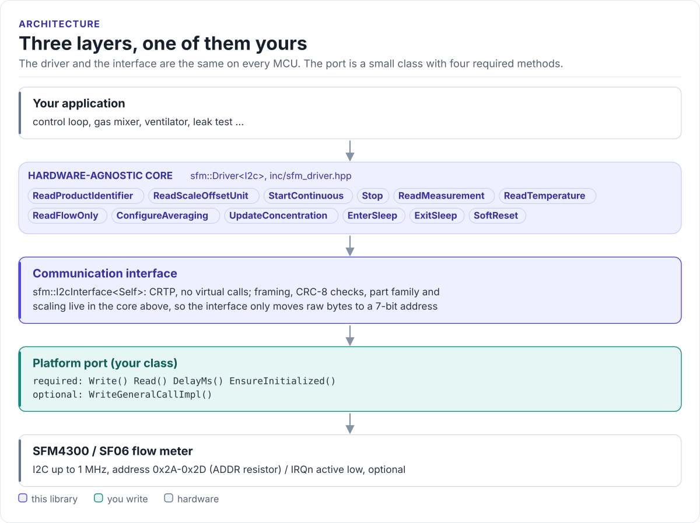

# SFM Flow Meter Driver

A header-only C++17 driver for Sensirion SF06-family gas mass flow meters such as the SFM4300: identify the part,
measure a gas or an O2 mixture and read flow, temperature and status with every word CRC-checked, from any MCU
with I2C.

[](https://github.com/hardfoc/hf-sfm-flow-meter-driver/actions/workflows/ci-host-tests.yml)
[](https://github.com/hardfoc/hf-sfm-flow-meter-driver/actions/workflows/esp32-examples-build-ci.yml)
[](https://hardfoc.github.io/hf-sfm-flow-meter-driver/)
[](LICENSE)

**Documentation: <https://hardfoc.github.io/hf-sfm-flow-meter-driver/>**

<!-- figure: driver-layers -->
<picture>
  <source media="(prefers-color-scheme: dark)" srcset="docs/diagrams/driver-layers.dark.svg">
  
</picture>
<!-- /figure -->

## In 30 seconds

Write a small port class for your MCU (raw I2C write, raw I2C read, a delay;
[Porting](https://hardfoc.github.io/hf-sfm-flow-meter-driver/latest/porting/)), then:

<!-- generated: quickstart-code -->
```cpp
#include "sfm.hpp"

int read_air_flow(MyI2c& i2c, float& slm) {
  sfm::Driver<MyI2c> flow(i2c, sfm::addr::kSfm4300Default);  // ADDR to GND: 0x2A

  const auto id = flow.ReadProductIdentifier();              // 1. identify (idle mode only)
  if (!id) {
    return -1;                                               // wiring, pull-ups or address
  }

  if (!flow.StartContinuous(sfm::Gas::Air)) {                // 2. read the scaling, start, wait 12 ms
    return -2;
  }

  const auto m = flow.ReadMeasurement();                     // 3. flow, temperature, status
  if (!m) {
    return m.error == sfm::DriverError::NoData ? 1 : -3;     // NoData: no new sample yet
  }
  slm = m.value.flow;                                        // standard litres per minute
  return 0;
}
```
<!-- /generated -->

## What it does

- Every SF06 command: start per gas or O2 mixture, read, flow-only read, averaging, concentration update,
  scale / offset / unit, sleep, product identifier and general-call soft reset.
- Decodes the product identifier into a variant and refuses gases the part is not calibrated for
  (`UnsupportedGas`, for example CO2 on an SFM4300-50).
- Converts raw counts to slm with the scale factor and offset the sensor reports for the active gas.
- Checks the CRC-8 of every received word; reports the sensor's "no new sample" NACK as `NoData`.
- Supports the SFx6000 family (SFM6000D) with its own gas codes, frame layout and temperature read.
- No heap, no exceptions, no RTOS, no virtual calls (the port is a CRTP class).

## Install

```bash
git submodule add https://github.com/hardfoc/hf-sfm-flow-meter-driver.git external/hf-sfm-flow-meter-driver
```

```cmake
add_subdirectory(external/hf-sfm-flow-meter-driver)
target_link_libraries(my_app PRIVATE hf::sfm)
```

ESP-IDF: use the component wrapper in [`examples/esp32/components/hf_sfm`](examples/esp32/components/hf_sfm/CMakeLists.txt).
Details: [Installation](https://hardfoc.github.io/hf-sfm-flow-meter-driver/latest/installation/).

## Documentation

| | |
| --- | --- |
| [Quickstart](https://hardfoc.github.io/hf-sfm-flow-meter-driver/latest/quickstart/) | Wire it, write the port, read a flow |
| [Hardware](https://hardfoc.github.io/hf-sfm-flow-meter-driver/latest/hardware/) | Pins, addresses, bus settings, timing, power, fluidics |
| [I2C protocol](https://hardfoc.github.io/hf-sfm-flow-meter-driver/latest/i2c-protocol/) | Commands, frames, CRC-8, scaling, status word |
| [API guide](https://hardfoc.github.io/hf-sfm-flow-meter-driver/latest/api-guide/) | Identify, start, read, average, handle errors |
| [Examples](https://hardfoc.github.io/hf-sfm-flow-meter-driver/latest/examples/) | ESP32-S3 applications |
| [API reference](https://hardfoc.github.io/hf-sfm-flow-meter-driver/latest/api/) | Doxygen, every class and member |

The pages are in [`docs/`](docs/index.md). The protocol constants were cross-checked against Sensirion's
BSD-3-Clause reference driver; see [`THIRD_PARTY_NOTICES.md`](THIRD_PARTY_NOTICES.md).

## Tests

```bash
cmake -S . -B build-host -DHF_SFM_BUILD_TESTS=ON && cmake --build build-host && ctest --test-dir build-host
```

The host tests replay datasheet frames through a fake I2C bus; the code on the documentation site is compiled by
the same build.

## License

MIT. See [LICENSE](LICENSE).
