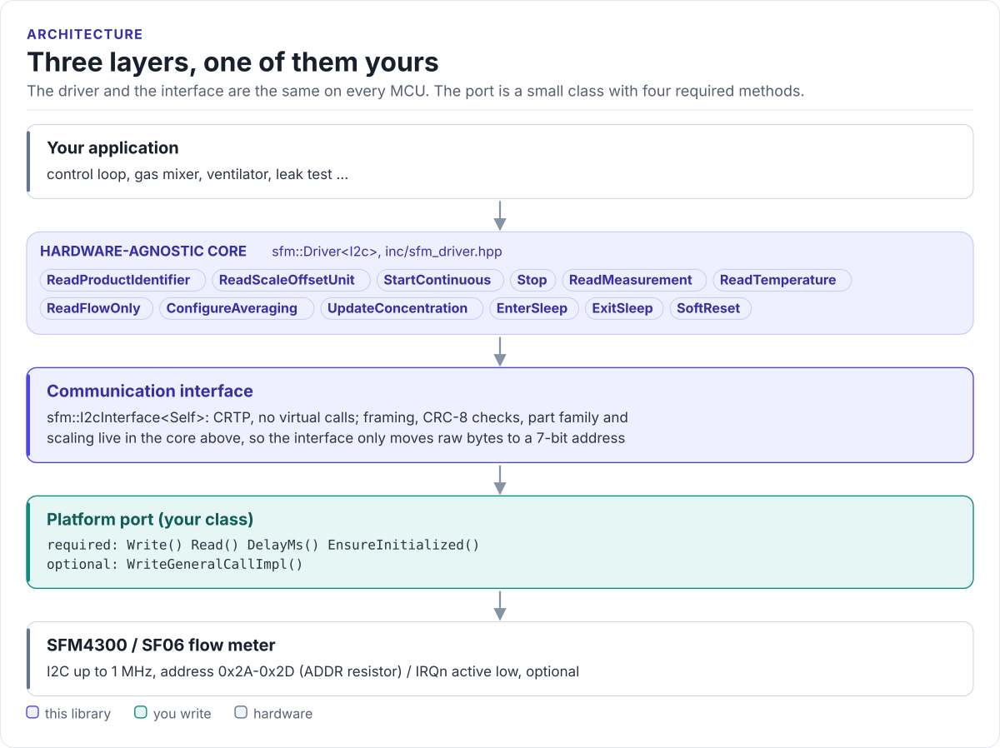
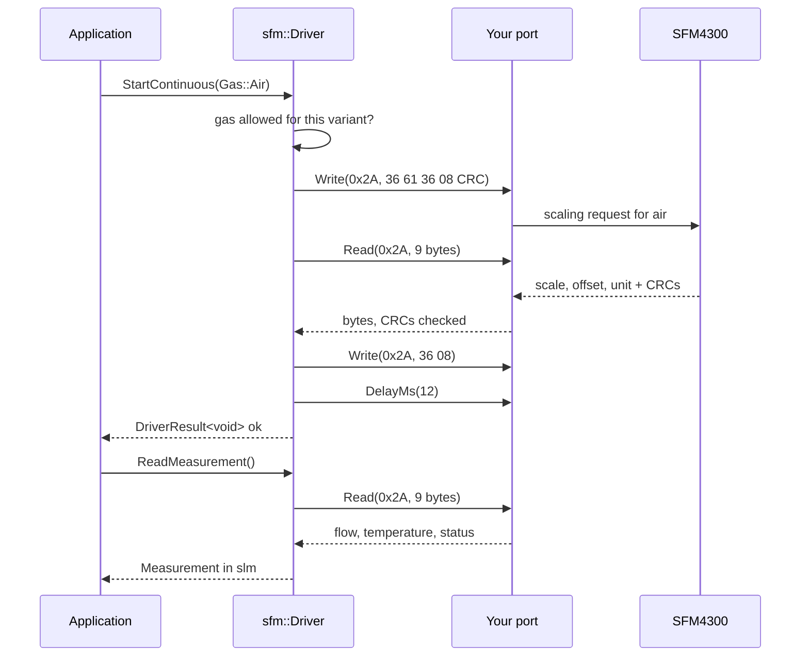

# Architecture

How the driver is put together: three layers, what each owns, and how one call reaches the sensor.

<!-- figure: driver-layers -->
<picture>
  <source media="(prefers-color-scheme: dark)" srcset="diagrams/driver-layers.dark.svg">
  
</picture>
<!-- /figure -->

## The three layers

| Layer | Where | Depends on | You change it when |
| --- | --- | --- | --- |
| **Hardware-agnostic core**: `sfm::Driver<I2cT>` | [`inc/sfm_driver.hpp`](../inc/sfm_driver.hpp), [`inc/sfm_types.hpp`](../inc/sfm_types.hpp), [`inc/sfm_commands.hpp`](../inc/sfm_commands.hpp) | The interface's methods only | Never, for a new board |
| **Communication interface**: `sfm::I2cInterface<Derived>` | [`inc/sfm_i2c_interface.hpp`](../inc/sfm_i2c_interface.hpp) | Four methods of your port, one optional | Never |
| **Platform port**: your class | Your project | Your SDK | Once per MCU or board ([Porting](porting.md)) |

Everything above the port is the same on ESP32, STM32, a Linux host or the unit-test fake. That is how the
[host tests](testing.md) run the real driver code without hardware.

## How one call reaches the sensor

## What the core keeps

The driver object holds a handful of values between calls, and no buffers:

| State | Set by | Used for |
| --- | --- | --- |
| Address | Constructor, `SetAddress()` | Every transfer |
| Part family (`Sf06` or `Sfx6000`) | Constructor, `ReadProductIdentifier()`, `AssumeVariant()` | Which start code means which gas; frame layout; which commands exist |
| Variant | `ReadProductIdentifier()`, `AssumeVariant()` | Which gases are calibrated (`SupportsGas()`) |
| Scaling of the active gas | `StartContinuous()` | Raw counts to slm in every read |
| Active gas, measuring flag | `StartContinuous()`, `Stop()`, `SoftReset()` | `ActiveGas()`, `Measuring()` |

## Why CRTP

The interface is a class template parameter, not a virtual base class. The compiler sees your port's methods
directly and inlines them; the driver has no vtable, allocates nothing and needs no RTTI. The optional
`WriteGeneralCallImpl()` is detected at compile time: a port without it still compiles, and `SoftReset()` returns
`NotSupported`. The cost is that the driver type names the port: `sfm::Driver<MyI2c>`.

## Results instead of exceptions

Every command returns `sfm::DriverResult<T>`: a `value` and an `error` (`sfm::DriverError`). It converts to
`bool`, so `if (!r)` is the check. `ToString(error)` gives a stable name for logs. The
[API guide](api-guide.md#handle-errors) lists what each error means.

## Source map

| Path | Contents |
| --- | --- |
| `inc/sfm.hpp` | Umbrella header, `GetDriverVersion()` |
| `inc/sfm_driver.hpp` | `sfm::Driver<I2cT>`: commands, framing, decoding |
| `inc/sfm_i2c_interface.hpp` | `sfm::I2cInterface<Derived>` |
| `inc/sfm_types.hpp` | Results, errors, families, gases, variants, readings, status word |
| `inc/sfm_commands.hpp` | Addresses, command codes, timing, CRC-8 |
| `tests/` | Host unit tests and the compiled documentation snippets |
| `examples/esp32/` | ESP-IDF applications and the ESP-IDF I2C port |
