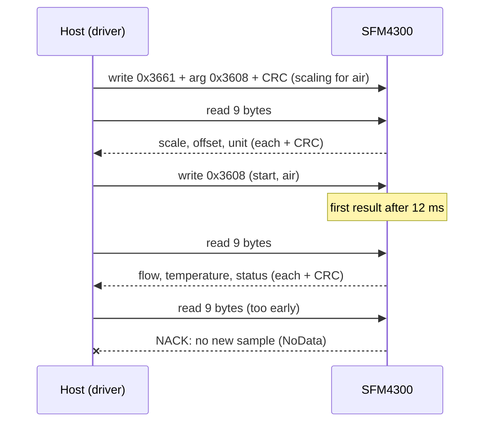

# Hardware

What to connect between your MCU and an SFM4300, with which bus settings and timing, and the limits to stay
inside.

All values here come from the
[SFM4300 datasheet](https://sensirion.com/media/documents/024CBAA1/62987ADF/Sensirion_Datasheet_SFM4300.pdf)
(version 1.0, April 2022). Other SF06 parts (SFM3003, SFM3013, SFM3019, SFM3119) use the same command set with
their own addresses, connectors and ratings: check their datasheets.

## Connector and pins

A JST NSH connector, 6 circuits, 1.0 mm pitch (board part BM06B-NSHSS-TBT).

| Pin | Name | Notes |
| --- | --- | --- |
| 1 | ADDR | Input: address select, open or GND, or a resistor to GND. Never connect it to VDD |
| 2 | SDA | I2C data; needs a pull-up |
| 3 | GND | Ground |
| 4 | VDD | Supply, 3.0 V to 5.5 V |
| 5 | SCL | I2C clock; needs a pull-up |
| 6 | IRQn | Output, active low: a sample is ready (or the sensor was reset). Leave it unconnected if unused |

## I2C address

The ADDR pin selects one of four 7-bit addresses. Resistor tolerance must be ±5 % or better.

| ADDR | Address | `sfm::addr::` |
| --- | --- | --- |
| GND or open | `0x2A` | `kSfm4300Default` |
| 1.2 kΩ to GND | `0x2B` | `kSfm4300Alt1` |
| 2.7 kΩ to GND | `0x2C` | `kSfm4300Alt2` |
| 5.6 kΩ to GND | `0x2D` | `kSfm4300Alt3` |

Default addresses of the other parts the driver knows: SFM3003-300-CL `0x28`, SFM3003-300-CE `0x2D`, SFM3119
`0x29`, SFM3019 `0x2E`, SFM3013 `0x2F`, SFM6000D `0x24` (`sfm::addr`). The soft reset uses the general-call
address `0x00`.

## Bus settings

| Setting | Value |
| --- | --- |
| Clock (fI2C) | 400 kHz typical, 1000 kHz maximum |
| Addressing | 7-bit, no register byte: a transfer is a raw write or a raw read |
| Command | 16 bits, MSB first; an argument adds 16 bits and a CRC-8 byte |
| Read | 16-bit words, MSB first, each followed by a CRC-8 byte; the host may stop after any word |
| CRC-8 | Polynomial 0x31, initial value 0xFF, no reflection, no final XOR; CRC(0xBEEF) = 0x92 |
| Pull-ups | Required on SDA and SCL, to the bus voltage; SDA and SCL must stay within -0.3 V to VDD + 0.3 V |
| No data | The sensor NACKs a read header while it has no new sample |

[I2C protocol](i2c-protocol.md) lists every command and frame.

## Timing

| Parameter | Time | What the driver does |
| --- | --- | --- |
| Power-up until the sensor answers | 16 ms typ., 20 ms max. | Nothing: power the sensor before the first call |
| Soft reset or exit sleep until ready | 16 ms typ., 20 ms max. | `SoftReset()` waits 20 ms; `ExitSleep()` polls for up to 20 ms |
| First result after a start command | 12 ms | `StartContinuous()` waits 12 ms |
| Warm-up for an accurate result | 30 ms typ. (includes the 12 ms) | Nothing: discard readings in the first 30 ms |
| Stop until the next command | 0.5 ms max. | `Stop()` waits 1 ms |
| Settling after a change of gas | 70 ms typ. | |
| Flow update rate, no averaging | 2000 Hz (1800 to 2200) | |
| Temperature update rate | 90 Hz (80 to 100) | |

## Power

| Parameter | Value | Notes |
| --- | --- | --- |
| Supply voltage VDD | 3.0 V to 5.5 V, 3.3 V typ. | Calibrated at 3.3 V; 3.3 V ±5 % is recommended |
| Power-up / power-down threshold | 2.3 V to 2.7 V, 2.5 V typ. | |
| Supply current, measuring | 4.2 mA typ., 5.7 mA max. | At VDD = 3.3 V |
| Supply current, idle | 0.055 mA typ., 0.6 mA max. | |
| Supply current, sleep | 0.4 µA typ., 1 µA max. | |

Absolute maximum VDD is 5.5 V. The operating temperature range is +5 °C to +50 °C; storage -40 °C to +80 °C.

## Fluidics

| Parameter | Value |
| --- | --- |
| Operating pressure | 0.66 bar to 7 bar absolute |
| Allowable overpressure | 10 bar gauge (no damage; specifications apply again afterwards) |
| Burst pressure | 20 bar gauge minimum |
| Pressure drop | Under 25 mbar at 20 slm (both ranges); under 100 mbar at 50 slm (SFM4300-50) |
| Orientation | Calibrated horizontal, connector facing up; other orientations add a small offset |

| Fitting suffix | Connection |
| --- | --- |
| `-B` | Basemount flanges, base plate with 7 mm inner-diameter openings. Fix it with the side screw holes only |
| `-O` | O-ring connection, port matched to an O-ring fitting with 8 mm inner-diameter openings |
| `-P` | 8 mm Legris push-in fittings: tube outer diameter 8 mm, inner diameter 6 mm or more |

The temperature the sensor reports is that of its silicon, not of the gas. It follows the gas, but also the
sensor's surroundings.

## Evaluation kit

| Kit | Contents |
| --- | --- |
| SEK-SFM4300-20-P | An SFM4300-20-P and an adapter cable; the SEK sensor bridge is ordered separately |

The [ESP32 examples](examples.md) run on an ESP32-S3 with SDA on GPIO 8 and SCL on GPIO 9 at 400 kHz; the
pins are set in each example's `using I2c = SfmEspIdfI2c<...>` line.

## Reference documents

| Document | What it is for |
| --- | --- |
| [SFM4300 datasheet](https://sensirion.com/media/documents/024CBAA1/62987ADF/Sensirion_Datasheet_SFM4300.pdf) | Pins, electrical and fluidic limits, timing, the SF06 command set, scaling |
| [`Sensirion/embedded-i2c-sfm-sf06`](https://github.com/Sensirion/embedded-i2c-sfm-sf06) | Sensirion's reference C driver (BSD-3-Clause); the protocol constants were cross-checked against it |
| [`THIRD_PARTY_NOTICES.md`](../THIRD_PARTY_NOTICES.md) | Its licence notice |
| [NXP UM10204](https://www.nxp.com/docs/en/user-guide/UM10204.pdf) | I2C-bus specification (rise times, pull-up sizing) |
