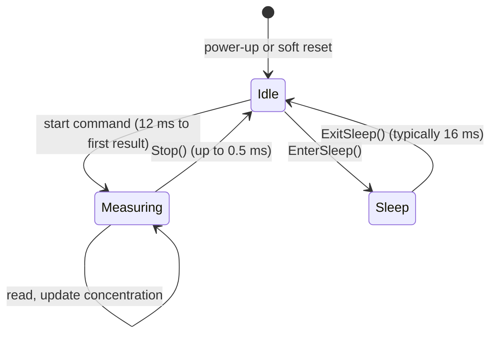

# Measurement and averaging

What one read returns, how often to read, and how the sensor's averaging and IRQn line change that.

## The measurement loop

After a start command the sensor measures continuously, about every 0.5 ms (2 kHz). Each read of the result
buffer returns the latest value of three signals: flow, temperature and the status word. The flow is averaged on
the sensor in one of two modes; the temperature updates at about 90 Hz.

Only idle mode accepts configuration commands: averaging, scaling, product identifier and sleep. While measuring,
the sensor takes stop, soft reset and the concentration update, and nothing else.

## Average-until-read (default)

`ConfigureAveraging(0)`, and the mode after power-up and after a reset. The sensor averages every sample since the
previous read, so a read at any rate returns the mean over the whole interval: a fixed-rate poll is anti-aliased
without a filter on the host.

For the first 64 ms after a read the average is the arithmetic mean. If you wait longer, the sensor switches to
exponential smoothing with α = 0.02 (status bit 11 set), which weights roughly the last 64 ms. Read at least every
64 ms to keep the plain mean.

## Fixed-N averaging

`ConfigureAveraging(N)` with N from 1 to 128: each result is the mean of N samples, so a new result is ready every
N × 0.5 ms. Reading earlier gets a NACK (`DriverError::NoData`). N = 1 turns averaging off. Status bit 10 is set
in this mode.

| N | New result every | Rate |
| --- | --- | --- |
| 1 | 0.5 ms | 2 kHz |
| 4 | 2 ms | 500 Hz |
| 20 | 10 ms | 100 Hz |
| 128 | 64 ms | about 16 Hz |

Configure averaging in idle mode, before `StartContinuous()`; the setting holds until a reset or the next
`ConfigureAveraging()`. The driver accepts 0 to 128 and returns `InvalidParameter` above.

## The IRQn line

IRQn goes low when a new result is ready (at 2 kHz, or 2 kHz / N with fixed-N averaging) and returns high when the
result is read. It is also low after power-up or a reset, until a start command. So a low IRQn after a start
means "result ready", unless the sensor was reset, in which case the read is NACKed.

Use it to read only when there is data: wait for the falling edge in a GPIO interrupt, read the 9-byte frame
there (or start a DMA transfer) and decode it with `Driver::DecodeMeasurement()`, which needs no bus access. The
[API guide](api-guide.md#read-from-an-interrupt-or-dma) shows it. Leave IRQn unconnected if you poll.

## What "NoData" means

A read header with no new result is NACKed by design. The driver reports it as `DriverError::NoData`: skip the
tick and read again later. It is a fault only when it never stops, which means the sensor is idle (no start, or it
was reset) or the address is wrong.

## Start-up

| Time after the start command | State |
| --- | --- |
| 0 to 12 ms | No result; reads are NACKed. `StartContinuous()` waits these 12 ms |
| 12 ms to 30 ms | Results arrive but can be a few percent off while the heater warms up |
| From 30 ms | Results within the datasheet accuracy |

Changing the gas with a new start command costs the same 12 ms, and 70 ms until the reading settles. To change
only the O2 fraction of a mixture, use `UpdateConcentration()`: it does not interrupt the measurement.

Next: [Gases and part families](part-families.md).
