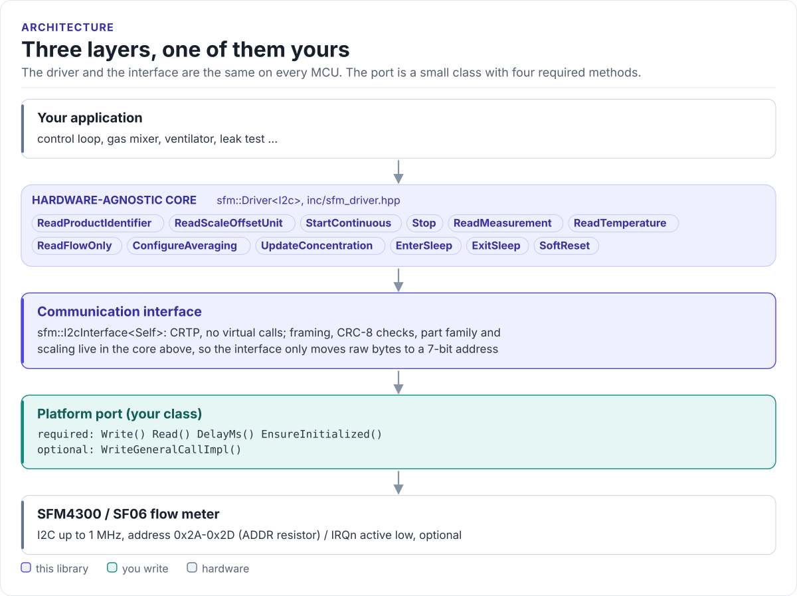

# Porting

Run the driver on a new MCU by writing one class: the I2C interface.

The driver never calls your SDK directly. It calls four methods, plus one optional, on a class you derive from
`sfm::I2cInterface<Self>` (in [`inc/sfm_i2c_interface.hpp`](../inc/sfm_i2c_interface.hpp)). The base class uses
CRTP: the calls are resolved at compile time, so there are no virtual functions, no vtable and nothing to
allocate.

<!-- figure: driver-layers -->
<picture>
  <source media="(prefers-color-scheme: dark)" srcset="diagrams/driver-layers.dark.svg">
  
</picture>
<!-- /figure -->

## What you implement

| Method | Required | Contract |
| --- | :---: | --- |
| `Write(addr7, data, len)` | yes | START, address + W, `len` bytes, STOP. No register byte. `len == 0` is an address-only probe. Return `false` on a NACK or bus error |
| `Read(addr7, out, len)` | yes | START, address + R, `len` bytes (NACK the last), STOP. Return `false` on an address NACK: that is the sensor's "no new sample" |
| `DelayMs(ms)` | yes | Block for at least `ms` milliseconds |
| `EnsureInitialized()` | yes | Bring the bus up if needed; return `true` when it is usable. Called at the start of every command |
| `WriteGeneralCallImpl(byte)` | no | Write one byte to the general-call address `0x00`. Without it `SoftReset()` returns `NotSupported` |

## The port

```cpp title="my_i2c.hpp"
--8<-- "tests/docs/my_i2c.hpp:port"
```

Rules the transfers must follow:

- **One transaction per call.** A command (two or five bytes) and a read (3, 9 or 18 bytes) are each one START to
  STOP transfer. Do not split them and do not add a register byte.
- **Report the NACK.** Reads of the result buffer are NACKed whenever no new sample is ready. Return `false` and
  let the driver turn it into `NoData`. Do not retry inside the port.
- **Read exactly `len` bytes.** A partial read hands the driver words with stale CRCs: `Crc` errors that come
  and go.
- **Support `len == 0` on `Write()`.** `ExitSleep()` probes the address with an empty write until the sensor
  acknowledges it. A port that cannot send an address-only write makes `ExitSleep()` fail.
- **Keep timeouts short.** A clock-stretching or stuck bus should fail the call, not block the control loop.

## Bus settings

| Setting | Value |
| --- | --- |
| Clock | 100 kHz to 1 MHz; 400 kHz is the typical choice |
| Pull-ups | External, on SDA and SCL. MCU internal pull-ups (tens of kΩ) are too weak above about 100 kHz |
| Address | 7-bit, from [the ADDR strap](hardware.md#i2c-address) |

## Reference implementation

The ESP32 examples use
[`hf_sfm_esp_i2c.hpp`](../examples/esp32/main/include/hf_sfm_esp_i2c.hpp): `SfmEspIdfI2c<port, sda, scl, hz>`, a
template port on the ESP-IDF `driver/i2c.h` API with FreeRTOS delays and the general-call write. Call its static
`Install()` once before the first driver call. Start from it for any ESP-IDF target.

## Check your port

1. Build it: the port on this page is compiled by the host CI from [`tests/docs/`](../tests/docs/my_i2c.hpp), with
   the driver instantiated over it.
2. Call `ReadProductIdentifier()`: a decoded `Variant` proves raw writes, 18-byte reads and CRC handling.
3. Start air and read for a second: `NoData` should be rare at 1 kHz polling and frequent at 5 kHz; `Crc` should
   stay at zero.
4. Call `EnterSleep()` then `ExitSleep()`: success proves the address-only write.

## Threads

The driver is not thread-safe. Give each sensor one owner task, or guard every call on a driver object, and the
port it shares with other devices on the bus, with one mutex.

Next: [Examples](examples.md).
